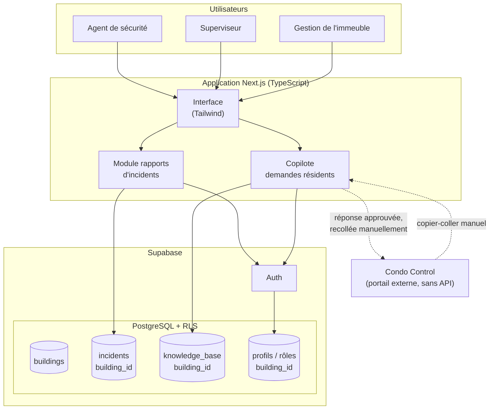
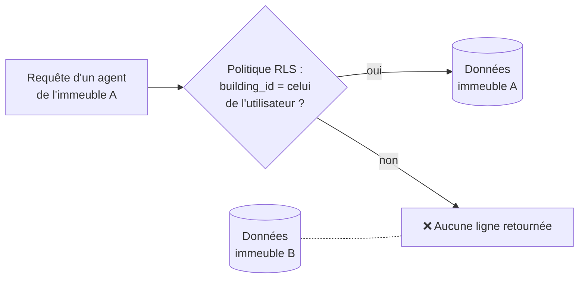
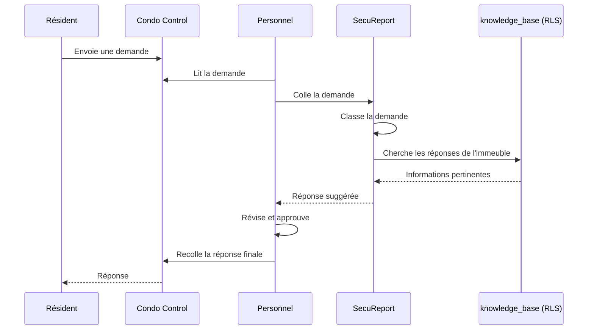

# 🛡️ SecuReport — architecture et fonctionnement

> **Étude de cas technique.** SecuReport est un logiciel SaaS **multi-immeubles** de rapports d'incidents pour les équipes de sécurité résidentielles. Je l'ai conçu et développé, et il est offert sous licence par ma compagnie, Novyxs.
> Le code source reste **privé** : c'est un produit commercial. Ce dépôt explique l'architecture, les choix techniques et les contraintes, sans le code.

**Auteur :** Amine Meliouh · Montréal
**Statut :** fonctionnel pour un premier immeuble, architecture multi-immeubles en cours de déploiement

---

## 1. Le problème

Je travaille comme agent de sécurité dans un immeuble résidentiel haut de gamme à Montréal. Les incidents y étaient consignés **sur papier**, ce qui posait plusieurs problèmes :

- aucune recherche possible dans l'historique ;
- un suivi difficile entre les quarts de travail ;
- aucune statistique ni aucun rapport pour la gestion ;
- un risque de perte ou de mauvaise lisibilité des rapports.

En plus, les demandes des résidents arrivent par **Condo Control**, un portail externe que l'équipe ne peut ni modifier ni remplacer, et qui n'offre pas d'accès API.

## 2. La solution

Une application web où les agents **créent, consultent et suivent** les rapports d'incident à partir de n'importe quel appareil. Chaque immeuble a ses propres données, entièrement isolées des autres. Un **copilote** aide aussi le personnel à répondre aux demandes des résidents.

---

## 3. Stack technique

| Couche | Technologies |
|---|---|
| Front-end | **Next.js**, React, **TypeScript**, Tailwind CSS, icônes Lucide |
| Back-end et base de données | **Supabase** : PostgreSQL et authentification |
| Sécurité des données | **Row Level Security (RLS)** de PostgreSQL |
| Outils | VS Code et WebStorm, Git, Node.js, développement assisté par IA (Claude Code) |

---

## 4. Architecture

### Le modèle multi-tenant

Chaque immeuble est un **tenant**.

- **Toutes les tables d'affaires** (incidents, base de connaissances, profils…) ont une colonne **`building_id`**.
- Des **politiques RLS** dans PostgreSQL limitent chaque requête aux données de l'immeuble de l'utilisateur connecté.
- L'isolation est donc assurée **par la base de données elle-même**, pas seulement par l'interface. Même si le code de l'interface contenait une erreur, un utilisateur ne pourrait pas lire les données d'un autre immeuble.

### Rôles

| Rôle | Permissions principales |
|---|---|
| Agent | Créer et consulter les rapports de son immeuble |
| Superviseur | Réviser et suivre les rapports de son équipe |
| Gestion | Consulter l'ensemble des rapports de l'immeuble et en faire le suivi |

---

## 5. Le copilote pour les demandes des résidents

**Contrainte :** Condo Control ne peut pas être modifié et n'offre aucun accès API.

**Solution :** un modèle *copilote* qui garde un **humain dans la boucle** :

- La **base de connaissances** est propre à chaque immeuble (`building_id`) et protégée par RLS.
- Aucune intégration avec le système externe n'est nécessaire : le copilote fonctionne **à côté** de l'outil existant.
- C'est un modèle réutilisable pour **s'intégrer à un système verrouillé sans API**.

---

## 6. Décisions de conception

### Ce qui crée de la dette technique si on le remet à plus tard → fait dès le départ
- `building_id` sur toutes les tables d'affaires
- les politiques RLS
- le modèle de rôles

Ajouter le multi-tenant après coup aurait demandé de migrer toutes les données et de revoir chaque requête. J'ai donc construit ces fondations même si un seul immeuble utilise l'application pour l'instant.

### Ce qui peut attendre sans créer de dette → reporté volontairement
- un sélecteur d'immeuble dans l'interface
- un tableau de bord qui couvre plusieurs immeubles
- la gestion de la facturation

### Modèle d'affaires
- **SaaS sous licence, pas une vente** : une licence par immeuble, offerte par Novyxs. Le code source n'est jamais transféré, ce qui protège les revenus récurrents et me laisse le contrôle de l'évolution du produit.
- **Déploiement progressif** : prouver la valeur dans un premier immeuble, puis l'étendre aux autres immeubles du même gestionnaire. Ça réduit la friction de la première vente.

---

## 7. Contraintes du projet

| Contrainte | Réponse |
|---|---|
| Utilisateurs non techniques, qui remplissent les rapports pendant leur quart | Une interface simple et rapide, accessible sur n'importe quel appareil |
| Données sensibles (incidents, résidents) | Isolation par RLS, contrôle d'accès par rôle, principe du moindre privilège |
| Portail résidents externe et verrouillé | Le modèle copilote avec un humain dans la boucle |
| Croissance vers plusieurs immeubles | Une architecture multi-tenant dès le départ |
| Projet construit seul, à côté d'un emploi et des études | Un découpage clair entre ce qui est essentiel et ce qui peut attendre |

---

## 8. Ce que ce projet m'a appris

- Concevoir un modèle de données **multi-tenant** et le sécuriser avec **PostgreSQL RLS**.
- Appliquer une logique de **sécurité dès la conception** : isolation au niveau de la base de données, moindre privilège.
- Partir d'un vrai problème vécu sur le terrain et le transformer en produit.
- Faire des arbitrages entre l'architecture et les fonctionnalités, selon la dette technique qu'ils créent.
- Préparer un plan de **tests de sécurité** avant le lancement, basé sur le OWASP Top 10 (OWASP ZAP, Nuclei, tests manuels des rôles et des sessions).

---

📫 [LinkedIn](https://www.linkedin.com/in/amine-meliouh-31a32427a) · 🌐 [Portfolio](https://aminemelh.github.io/portfolio-amine/) · 🤖 [Chatbot Novyxs](https://github.com/Aminemelh/chatbot-novyxs)
